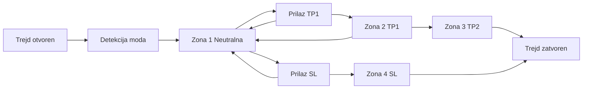

# TELEGRAM_MESSAGES_MASTER_PLAN.md

Zakon za Telegram obaveštenja o trejdovima u Tradelyt-u: modovi, zone, poruke, rotacija, dugmad i skladištenje.

Pravila zaključana: 2026-11-14 (30 odluka, poglavlje 15). Tačke O1–O5 zatvorene istog dana usvajanjem privremenih pravila, jer je plan odobren za izvršenje (poglavlje 13). Tekstovi 39 poruka još nisu uneti (poglavlje 14).

---

## 1. Kako se ovaj fajl koristi

- Za sve što se tiče Telegram poruka o trejdovima, ovaj fajl pobeđuje `PROJECT_CONTEXT.md`. Za sve ostalo (brend, naplata, identitet, enkripcija, discipline score) i dalje važi `PROJECT_CONTEXT.md`.
- Promena pravila ide prvo ovde, pa tek onda u bazu i kod.
- Tekst poruke koji je zaključan menja se samo na izričit nalog vlasnika proizvoda. Stara verzija se čuva.
- Tačke koje su bile označene kao izvedene zaključane su u poglavlju 13.

### 1.1 Šta ovaj fajl menja u PROJECT_CONTEXT.md

`PROJECT_CONTEXT.md` je usklađen 2026-11-14. Ova lista je ono što u njemu više ne važi, i tamo je zamenjeno uputnicom na ovaj fajl:

| Poglavlje | Staro pravilo | Novo pravilo |
|---|---|---|
| 8.2, 10.1, 17 (tačka 7) | Mod bira korisnik: `/mode` i `bot_settings.discipline_mode` | Mod se računa po trejdu. `/mode` i ručni izbor se ukidaju |
| 10.2, 17 (tačka 4) | Tiho osvežavanje šalje poruke u ritmu 30s/15s, 5m/2m, 30m/10m | Jedna živa poruka po trejdu koja se edituje (poglavlje 4.1) |
| 10.4 | TP1 i TP2 se šalju jednom | Ponavljaju se kad cena ponovo pređe prag (poglavlje 4) |
| 10.4 | `sl_hit` se šalje jednom | Do 3 ponavljanja na po 5 minuta dok je trejd otvoren (poglavlje 4) |
| 12 | Količina u manual unosu je opciona | Veličina pozicije je obavezna |
| 5, 17 (tačke 22, 23) | Praćenje cena radi samo Express engine | Privremeno Vercel cron na 1 minut (poglavlje 11) |

Ostaje netaknuto: discipline score, alarmi za pomeren ili uklonjen SL, trejd bez SL, dnevni limit, hedge, drawdown, dnevni izveštaj, tihi sati, `/pause`, pravila pretplate, zabrana slanja naloga na berzu, zabrana reči „AI“.

---

## 2. Modovi i automatska detekcija

Tri moda: `scalper`, `classic`, `moonshot`. Korisnik ne bira mod. Backend ga računa za svaki trejd posebno i čuva u `trades.mode`.

### 2.1 Pravilo detekcije

Glavni signal je udaljenost TP1 od ulaza, kao procenat kretanja cene:

```
tp1_distance% = abs(take_profit_1 - entry_price) / entry_price * 100
```

| `tp1_distance%` | Mod |
|---|---|
| manje od 7,5 | Scalper |
| od 7,5 do ispod 17,5 | Classic |
| 17,5 i više | Moonshot |

Granice su sredine između referentnih TP1 vrednosti modova (5, 10, 25).

Ako TP1 ne postoji, koristi se udaljenost SL od ulaza:

| `sl_distance%` | Mod |
|---|---|
| manje od 5 | Scalper |
| od 5 do ispod 11 | Classic |
| 11 i više | Moonshot |

Ako ne postoje ni TP1 ni SL, čeka se do 2 minuta od otvaranja. Ako se u tom roku pojave, važi pravilo iznad. Ako se ne pojave, trejd dobija Classic. Poruka otvaranja se šalje tek kad je mod poznat.

Vremenski okvir se ne koristi u detekciji.

### 2.2 Promena moda u toku trejda

Mod se ponovo računa svaki put kad se promeni SL ili TP. Ako se mod promeni:

- `trades.mode` dobija novu vrednost
- pragovi zona se računaju iz novog moda od sledeće provere
- živa poruka se ponovo iscrtava sa novim modom
- nema posebne poruke „mod je promenjen“
- alarm koji je već otišao ne ide ponovo samo zato što se mod promenio; ako novi pragovi stave trejd u drugu zonu, to je običan prelaz zone

---

## 3. Zone

### 3.1 Referentna tabela procenata

| Zona | Scalper | Classic | Moonshot |
|---|---|---|---|
| Zona 1: Neutralna | od -2% do +4% | od -5% do +9% | od -10% do +24% |
| Prilaz TP1 (pod-zona) | od +4% do ispod +5% | od +9% do ispod +10% | od +24% do ispod +25% |
| Zona 2: TP1 | +5% | +10% | +25% |
| Zona 3: TP2 | +10% | +20% | +50% |
| Prilaz SL (pod-zona) | ispod -2% do iznad -3% | ispod -5% do iznad -7% | ispod -10% do iznad -15% |
| Zona 4: SL | -3% | -7% | -15% |

Short pozicije koriste istu tabelu u ogledalu: profit je pad cene.

### 3.2 Osnova procenta

Procenat zone je PnL trejda u odnosu na ukupan kapital naloga:

```
zone% = pnl_usd / equity * 100
```

Kapital dolazi samo sa berze, preko read-only ključa, i uzima se u trenutku otvaranja trejda (`trades.equity_at_open`).

Kad kapital nije poznat, procenat je kretanje cene od ulaza, bez leverage-a. Cron na Vercelu ne dekriptuje API ključeve i ne zove privatni API berze, pa u toj fazi kapital nije poznat i važi kretanje cene. Ovo je odluka O1.

### 3.3 Šta pali alarm

Alarm pale stvarne cene koje je korisnik postavio. Procenti moda važe samo za prag koji korisnik nije postavio.

| Prag | Ako je korisnik postavio cenu | Ako nije |
|---|---|---|
| TP1 | cena dotakne `take_profit_1` | `zone%` dostigne TP1 procenat moda |
| TP2 | cena dotakne `take_profit_2` | `zone%` dostigne TP2 procenat moda |
| SL | cena dotakne `stop_loss` | `zone%` padne na SL procenat moda |

### 3.4 Pod-zone prilaza

Rupa između neutralne zone i praga je posebna pod-zona sa tihim upozorenjem. Njene poruke su van 39 master pozicija.

Tačno na ivici neutralne zone ostaje Zona 1. Prilaz počinje tek posle te ivice.

Kad prag dolazi iz procenta moda, granice su iz tabele 3.1. Kad prag dolazi iz korisnikove cene, pod-zona počinje na istom delu puta od ulaza do praga koji važi u tabeli:

| Mod | Prilaz TP1 počinje na | Prilaz SL počinje na |
|---|---|---|
| Scalper | 80% puta do TP1 (4 od 5) | 66,7% puta do SL (2 od 3) |
| Classic | 90% puta do TP1 (9 od 10) | 71,4% puta do SL (5 od 7) |
| Moonshot | 96% puta do TP1 (24 od 25) | 66,7% puta do SL (10 od 15) |

### 3.5 Tok zona



Posle TP1 SL prag ostaje na originalnom mestu. Ne pomera se na ulaznu cenu. Trejd čeka TP2.

---

## 4. Ponašanje po zonama

| Zona | Šta bot radi | Zvuk | Ponavljanje | Tihi sati |
|---|---|---|---|---|
| Zona 1: Neutralna | Jedna poruka pri otvaranju trejda. Posle toga se ista poruka samo edituje | bez zvuka posle otvaranja | ne | ćuti |
| Prilaz TP1 / Prilaz SL | Tiho upozorenje | bez zvuka | po ulasku u pod-zonu | ćuti |
| Zona 2: TP1 | Nova poruka, savet da se uzme deo profita | sa notifikacijom | svaki put kad cena ponovo pređe prag, uz pauzu | odlaže se do kraja tihih sati |
| Zona 3: TP2 | Nova poruka, savet da se zaključa profit | sa notifikacijom | isto kao TP1 | odlaže se do kraja tihih sati |
| Zona 4: SL | Nova poruka, hitna evakuacija | sa notifikacijom | prvi alarm + najviše 3 ponavljanja na po 5 minuta | prolazi uvek |
| Specijalna | Nova poruka, upozorenje o pozicijama i kapitalu | sa notifikacijom | po događaju | prolazi uvek |

Dodatna pravila:

- TP1 i TP2 ponavljanje prestaje kad korisnik potvrdi dugmetom. Pauza posle alarma, odluka O3: Scalper 15 minuta, Classic 1 sat, Moonshot 4 sata. Novi alarm ide tek kad se cena prethodno vratila u Zonu 1 i pauza je istekla.
- SL ponavljanje prestaje kad korisnik klikne dugme, kad se cena vrati iznad praga, ili kad se trejd zatvori. Ako je berza već zatvorila poziciju na SL nalogu, ide samo prvi alarm.
- `/pause` gasi sve poruke, uključujući SL. Upis u bazu se nastavlja.
- „Zvučni alarm“ je obična Telegram notifikacija. Bot ne može da pusti poseban zvuk niti da probije utišan chat.
- Poruke idu samo korisniku čija pretplata dozvoljava poruke (`PROJECT_CONTEXT.md` 7.1) i koji nije blokirao bota.

### 4.1 Živa poruka

Svaki otvoren trejd ima tačno jednu živu poruku. Ona se edituje bez notifikacije.

- Živa poruka je uvek najnovija poruka tog trejda. Kad ode alarm zone, on postaje živa poruka, a prethodna gubi dugmad.
- Edit ide samo ako se PnL promenio bar za prag od poslednjeg edita: Scalper 0,3, Classic 1, Moonshot 3 procentna poena.
- Najčešći ritam edita u cron fazi: Scalper svaki minut; Classic 5 minuta u profitu, 2 minuta u minusu; Moonshot 30 minuta u profitu, 10 minuta u minusu.
- Zatvoren trejd više ne dobija edit.

### 4.2 Vremenski okidač za pasivan trejd

Jedan okidač po modu:

| Mod | Okidač |
|---|---|
| Scalper | 30 minuta |
| Classic | 2 sata |
| Moonshot | 6 sati |

Trejd je pasivan kad je toliko vremena neprekidno u Zoni 1. Okidač samo osvežava živu poruku i upisuje u nju da je trejd pasivan. Ne šalje novu poruku i nema zvuk. Brojač kreće iznova kad trejd izađe iz Zone 1 i vrati se u nju.

---

## 5. Specijalna situacija (zaštita početnika)

Dva okidača, ista grupa od 3 poruke. Poruke nisu vezane za mod.

**Okidač A, previše pozicija na istom trejdu.** Broji se dodavanje na istu poziciju (isti simbol i isti smer). Otvaranje plus jedno dodavanje su 2 pozicije i ne pale ništa. Treća pozicija i svaka sledeća pale upozorenje. Dodavanje i dalje nije novi trejd i ne diže `total_trades`.

**Okidač B, previše trejdova u periodu.** Klizni prozori od 6, 12 i 24 sata. Odluka O4: prag za 24 sata je `max_daily_trades`, za 12 sati polovina, za 6 sati četvrtina, zaokruženo naviše. Limit 0 gasi okidač B. Prekoračenje je broj trejdova strogo veći od praga. Ako jedno otvaranje probije više prozora, ide jedna poruka, za najkraći probijen prozor.

Poruka objašnjava odnos trenutnog kapitala i otvorenih pozicija. Kapital dolazi samo sa berze. Korisnik bez ključa dobija istu poruku bez dela o kapitalu.

Specijalna situacija sama ne skida discipline score. Postojeći alarm za dnevni limit i njegova kazna ostaju kako jesu.

---

## 6. Struktura poruka

### 6.1 39 master pozicija

| Grupa | Račun | Pozicija |
|---|---|---|
| Zone | 3 moda × 4 zone × 3 varijacije | 36 |
| Specijalna | 3 varijacije | 3 |
| Ukupno | | 39 |

Tri varijacije su tri različite formulacije iste poruke na istom jeziku. Svaka pozicija postoji na srpskom i na engleskom, što daje 78 tekstova. Jezik se bira po `users.language`.

Poruke pod-zona prilaza su van ovih 39. Odluka O2: struktura ih podržava (`approach_tp1`, `approach_sl`). Dok vlasnik ne pošalje tekstove, pod-zona ne šalje novu poruku, samo edituje živu poruku.

### 6.2 Šifre pozicija

Format: `<MOD>-<ZONA>-<VARIJACIJA>`, sa jezikom na kraju kad treba.

- Mod: `SC` Scalper, `CL` Classic, `MS` Moonshot
- Zona: `Z1` Neutralna, `Z2` TP1, `Z3` TP2, `Z4` SL
- Varijacija: `V1`, `V2`, `V3`
- Specijalna: `SP-V1`, `SP-V2`, `SP-V3`

Primer: `CL-Z2-V1-sr` je Classic, TP1, prva varijacija, srpski.

### 6.3 Sastav jedne poruke

Okvir je zajednički za zonu. Varijacija menja samo telo.

1. Zaglavlje zone: oznaka zone, naziv zone, mod.
2. Telo: jedna od 3 varijacije.
3. Status blok sa živim podacima: koin, smer, ulazna cena, trenutna cena, PnL u dolarima, PnL u procentima, trajanje trejda.
4. Dugmad (poglavlje 8).

Vizuelni identitet: Neutralna je plava i mirna, TP1 i TP2 su zeleni i rastući, SL je crven. Telegram ne boji poruke, pa identitet nose emodži i zaglavlje. Tačni emodžiji se zaključavaju zajedno sa tekstovima.

### 6.4 Živi podaci

Promenljive se pišu u vitičastim zagradama:

| Promenljiva | Sadržaj |
|---|---|
| `{coin}` | simbol, npr. BTCUSDT |
| `{entry_price}` | ulazna cena |
| `{current_price}` | trenutna cena |
| `{pnl_usd}` | PnL u dolarima, sa znakom |
| `{pnl_pct}` | PnL u procentima, sa znakom |
| `{duration}` | trajanje trejda od otvaranja |
| `{name}` | ime korisnika po pravilu iz `PROJECT_CONTEXT.md` poglavlje 10 |
| `{side}` | LONG ili SHORT |
| `{entries}` | broj ulaza na istu poziciju, samo specijalna situacija |
| `{open_count}` | broj trejdova u prozoru, samo specijalna situacija |
| `{window}` | `6h`, `12h` ili `24h` |
| `{limit}` | prag tog prozora |
| `{equity}` | kapital pri otvaranju, ili prazno ako nije poznat |

Nepoznata promenljiva u tekstu je greška pri upisu, ne pri slanju. PnL u dolarima traži veličinu pozicije, pa je ona obavezna pri ručnom unosu trejda.

---

## 7. Rotacija varijacija

- Pri svakom slanju bira se nasumično jedna od aktivnih varijacija za (mod, zona, jezik).
- Ista varijacija ne ide dva puta zaredom.
- Pamćenje je po trejdu i zoni. Novi trejd kreće bez pamćenja.
- Poslednja poslata varijacija se čita iz `notifications_log` za taj trejd i tu zonu. Ona se izbacuje iz izbora, a bira se nasumično između preostalih.
- Ako se mod promenio u toku trejda, bira se iz varijacija novog moda.

---

## 8. Akciona dugmad

Najviše dva dugmeta po poruci: potvrda akcije zone i „Zatvori praćenje“.

| Zona | Dugme akcije | Drugo dugme |
|---|---|---|
| Zona 1: Neutralna | nema | Zatvori praćenje |
| Prilaz TP1 / SL | nema | Zatvori praćenje |
| Zona 2: TP1 | Osiguran TP1 | Zatvori praćenje |
| Zona 3: TP2 | Profit zaključan | Zatvori praćenje |
| Zona 4: SL | Izašao sam | Zatvori praćenje |
| Specijalna | Razumem | nema |

Efekat klika:

| Dugme | Efekat |
|---|---|
| Osiguran TP1 | Bot pita koliki deo je zatvoren: 25%, 50% ili 75%. Upisuje realizovani PnL, preračunava ostatak pozicije, status `tp1_hit`. TP1 alarm se više ne ponavlja |
| Profit zaključan | Status `tp2_hit`, `closed_at`, praćenje staje |
| Izašao sam | Status `stopped`, `closed_at`, SL ponavljanje staje |
| Zatvori praćenje | Status `closed_manual`, `closed_at`, praćenje staje |
| Razumem | Samo potvrda, bez promene trejda |

Pravila:

- Dugmad samo usklađuju matematiku bota sa onim što je korisnik uradio na menjačnici. Bot nikad ne šalje nalog na berzu.
- Za trejd sa berze istina je berza. Dugme samo potvrđuje, količina se čita sa berze.
- Posle klika poruka gubi dugmad i dobija red potvrde.
- Klik na poruku zatvorenog trejda vraća kratko obaveštenje da je trejd već zatvoren.
- Tekstovi dugmadi se zaključavaju zajedno sa porukama, na oba jezika.

---

## 9. Skladištenje

Izvor istine za runtime je tabela u Neon bazi. Isti sadržaj stoji u repou kao seed, radi istorije u gitu.

Redosled autoriteta za tekst poruke: ovaj fajl (poglavlje 14), zatim seed, zatim baza. Seed i baza moraju da se slažu sa ovim fajlom od slova do slova.

Migracije su `db/migrations/0013_telegram_templates.sql` i `db/migrations/0014_trade_zones.sql`. Seed je `db/seeds/telegram-message-templates.sql` i prati poglavlje 14 od slova do slova. Dok je registar prazan, seed nema `INSERT`.

### 9.1 `telegram_message_templates` (nova tabela)

| Kolona | Tip | Pravilo |
|---|---|---|
| `id` | uuid PK | |
| `code` | text NOT NULL | šifra pozicije, npr. `CL-Z2-V1` |
| `mode` | text NULL | `scalper` \| `classic` \| `moonshot`; NULL za specijalnu |
| `zone` | text NOT NULL | `neutral` \| `tp1` \| `tp2` \| `sl` \| `special_positions` \| `approach_tp1` \| `approach_sl` |
| `variant` | smallint NOT NULL | 1 do 3 |
| `language` | text NOT NULL | `sr` \| `en` |
| `body` | text NOT NULL | telo poruke sa promenljivima |
| `version` | int NOT NULL | kreće od 1 |
| `is_active` | boolean NOT NULL | samo jedna aktivna verzija po (`code`, `language`) |
| `locked_at` | timestamptz NULL | kad je vlasnik potvrdio tekst |
| `created_at`, `updated_at` | timestamptz | |

Izmena zaključanog teksta je novi red sa `version + 1`. Stari red dobija `is_active = false` i ostaje u bazi. `body` zaključanog reda se nikad ne prepisuje.

### 9.2 Okvir zone

Zaglavlje, status blok i dugmad su zajednički po zoni i žive u kodu, u jednom modulu, na oba jezika. Nisu u tabeli poruka.

### 9.3 Dopune postojećih tabela

| Tabela | Dopuna | Zašto |
|---|---|---|
| `users` | `language` (`sr` \| `en`, default `en`) | kolona danas ne postoji |
| `trades` | `mode`, `source`, `quantity`, `remaining_quantity`, `leverage` | mod po trejdu, PnL u dolarima, delimično zatvaranje |
| `trades` | `zone`, `zone_changed_at`, `live_message_id` | trenutna zona, pasivan okidač, živa poruka |
| `trades` | `equity_at_open`, `position_entries`, `tp1_confirmed_at` | osnova procenta, okidač A, kraj TP1 ponavljanja |
| `trades` | status lista iz `PROJECT_CONTEXT.md` 8.6.1 | živa baza danas zna samo `open`, `closed`, `canceled`, `stopped` |
| `notifications_log` | `template_id`, `zone`, `mode`, `telegram_message_id` | rotacija, pauze ponavljanja, edit poruke |
| `notifications_log` | prošireni `notification_type` | tipovi za zone i specijalnu situaciju |
| `bot_settings` | `timezone`, `quiet_hours_*`; `discipline_mode` se više ne koristi za mod | tihi sati danas nisu u bazi |

---

## 10. Telegram API ograničenja

| Ograničenje | Posledica za nas |
|---|---|
| Tekst poruke do 4096 znakova | okvir + telo + status blok moraju stati; proverava se pri upisu teksta |
| `callback_data` dugmeta do 64 bajta | format `<akcija>:<trade_id>`, bez dodatnih podataka |
| Oko 30 poruka u sekundi ukupno, oko 1 u sekundi po chatu | red slanja sa prioritetom: SL, TP2, TP1, specijalna, prilaz, edit žive poruke |
| Odgovor 429 nosi `retry_after` | slanje čeka toliko, ne pokušava ranije |
| Edit sa istim tekstom vraća grešku | edit se preskače kad se tekst nije promenio |
| Svaki klik na dugme traži `answerCallbackQuery` | bez toga dugme kod korisnika ostaje u učitavanju |
| Webhook danas prima samo `message` i `my_chat_member` | za dugmad treba dodati `callback_query` |
| Bot ne bira zvuk i ne probija utišan chat | alarm je `disable_notification: false`, tiho je `true` |
| Nema boja poruke | identitet zone nose emodži i zaglavlje |
| Formatiranje preko `parse_mode` HTML | živi podaci se eskejpuju pre ubacivanja |
| Korisnik može da blokira bota | slanje se preskače dok je `users.telegram_blocked_at` postavljen |

Ponovljeni klik i ponovljena isporuka idu kroz postojeću `telegram_updates` tabelu.

---

## 11. Motor koji prati zone

Privremeno rešenje je Vercel cron na 1 minut. Express engine iz `PROJECT_CONTEXT.md` ostaje ciljna arhitektura.

Jedan prolaz crona:

1. Učita otvorene trejdove korisnika kojima poruke smeju da idu.
2. Uzme javne cene sa Bybit tickera u jednom pozivu.
3. Izračuna mod (ako se SL ili TP promenio) i zonu svakog trejda.
4. Za prelaz zone pošalje poruku, za ostalo edituje živu poruku ako je prag promene pređen.
5. Svako slanje upiše u `notifications_log`.

Posledice koje su prihvaćene:

- Cron ne dekriptuje ključeve i ne čita privatni API berze. Odluka O1.
- Alarm može da kasni do oko 1 minut. Za Scalper je to grubo.
- Cena koja između dva prolaza dotakne prag i vrati se može da promakne. Pri implementaciji proveriti da li se to pokriva najvišom i najnižom cenom minutne sveće.
- Dva prolaza ne smeju da pošalju isti alarm. Trejd se zauzima pre slanja, kao kod postojećeg podsetnika za checkout.
- Ruta traži `Authorization: Bearer` sa `CRON_SECRET`, kao postojeći cron.
- Raspored je `* * * * *` u `vercel.json`. Na Vercel Hobby planu cron sme da ide najčešće jednom dnevno, pa minutni prolaz traži plan koji to dozvoljava.

---

## 12. Motor zona

Motor je u kodu od 2026-11-14:

- unos trejda: `/trade`, `/close`, `/pause`, `/resume` i forma na dashboardu
- kolone iz poglavlja 9.3 u migraciji `0014`
- slanje sa dugmadima, HTML formatiranjem i editovanjem u `lib/telegram.ts`
- obrada `callback_query` u `app/api/webhooks/telegram/route.ts`
- rotacija bez ponavljanja u `lib/telegram-templates.ts`
- prolaz zona u `lib/trade-monitor.ts`, ruta `GET /api/cron/zones`, raspored svaki minut

`lib/telegram-messages.ts` i dalje drži podsetnik za karticu. Zone ga ne koriste.

---

## 13. Zatvorene tačke O1–O5

Zatvoreno 2026-11-14. Plan je odobren za izvršenje dok su ova pravila bila zapisana kao privremena. Usvojena su kakva jesu, bez novog izbora. Sledeća izmena ide samo na nalog vlasnika, prvo u ovo poglavlje.

| Šifra | Odluka |
|---|---|
| O1 | Bez poznatog kapitala procenat je kretanje cene od ulaza, bez leverage-a. Cron ne dekriptuje ključeve i ne zove privatni API berze. Kad je kapital poznat, uzima se stanje u trenutku otvaranja trejda |
| O2 | Pod-zone imaju mesta `approach_tp1` i `approach_sl`. Dok nema tekstova, pod-zona samo edituje živu poruku |
| O3 | Pauza ponovljenog TP1 i TP2: Scalper 15 minuta, Classic 1 sat, Moonshot 4 sata. Novi alarm ide tek kad se cena vratila u Zonu 1 i pauza je istekla. SL i dalje ide najviše 3 puta na po 5 minuta, bez čekanja povratka u Zonu 1 |
| O4 | 24 h = `max_daily_trades`, 12 h = polovina, 6 h = četvrtina, zaokruženo naviše. Limit 0 gasi okidač B. Prekoračenje je broj strogo veći od praga |
| O5 | Neutralna i prilaz nemaju dugme akcije, samo „Zatvori praćenje“. Specijalna ima samo „Razumem“ |

---

## 14. Registar poruka

Status pozicije: `prazno`, `nacrt` (tekst stigao, nije potvrđen), `zaključano` (potvrđen, menja se samo na nalog).

Postupak za svaku poruku: vlasnik pošalje tekst u chat, tekst se upiše ovde pod svoju šifru, zatim u seed i bazu čim tabela postoji. Pozicija je zaključana tek kad postoje i srpski i engleski tekst.

| Mod | Zona | V1 | V2 | V3 |
|---|---|---|---|---|
| Scalper | Z1 Neutralna | prazno | prazno | prazno |
| Scalper | Z2 TP1 | prazno | prazno | prazno |
| Scalper | Z3 TP2 | prazno | prazno | prazno |
| Scalper | Z4 SL | prazno | prazno | prazno |
| Classic | Z1 Neutralna | prazno | prazno | prazno |
| Classic | Z2 TP1 | prazno | prazno | prazno |
| Classic | Z3 TP2 | prazno | prazno | prazno |
| Classic | Z4 SL | prazno | prazno | prazno |
| Moonshot | Z1 Neutralna | prazno | prazno | prazno |
| Moonshot | Z2 TP1 | prazno | prazno | prazno |
| Moonshot | Z3 TP2 | prazno | prazno | prazno |
| Moonshot | Z4 SL | prazno | prazno | prazno |
| Specijalna | SP | prazno | prazno | prazno |

Zaključano: 0 od 39.

### 14.1 Tekstovi

Još nema unetih tekstova. Svaki tekst dolazi ovde pod naslovom svoje šifre, sa srpskom i engleskom verzijom.

### 14.2 Prijem teksta

Kad vlasnik pošalje tekst:

1. Provera: samo dozvoljene promenljive iz poglavlja 6.4, telo kraće od 3000 znakova, šifra postoji u registru.
2. Upis ovde, status `nacrt`, dok ne postoje oba jezika.
3. Kad su srpski i engleski potvrđeni, status `zaključano`, isti tekst u `db/seeds/telegram-message-templates.sql` i u tabelu.
4. Kasnija izmena je nova `version`, stari red ostaje sa `is_active = false`.

Dok je telo prazno, bot šalje samo okvir zone (zaglavlje, status blok, dugmad). Ne izmišlja telo.

---

## 15. Mapa odluka

Zatvoreno 2026-11-14.

1. Glavni signal detekcije moda je udaljenost TP1 od ulaza.
2. Granice između modova su najbliži prag (sredine između referentnih vrednosti).
3. Trejd bez SL i TP čeka do 2 minuta, zatim dobija Classic.
4. Mod se ponovo računa na svaku promenu SL ili TP.
5. `/mode` i `bot_settings.discipline_mode` se ukidaju. Mod postoji samo na nivou trejda.
6. Procenti zona su promena u odnosu na ukupan kapital naloga.
7. Alarm pale korisnikove stvarne TP i SL cene. Procenti moda važe samo kad cene nema.
8. Rupe između zona su pod-zona prilaza sa tihim upozorenjem, van 39 poruka.
9. Posle TP1 SL prag ostaje na originalnom procentu. Čeka se TP2.
10. TP1 i TP2 alarm idu svaki put kad cena ponovo pređe prag, uz pauzu.
11. SL alarm se ponavlja najviše 3 puta, na po 5 minuta.
12. Poruka Zone 1 ide samo pri otvaranju. Okidači samo osvežavaju postojeću poruku.
13. Vremenski okidač po modu: Scalper 30 minuta, Classic 2 sata, Moonshot 6 sati.
14. Tri varijacije su tri formulacije na istom jeziku.
15. Poruke postoje na srpskom i engleskom: 39 × 2 = 78 tekstova.
16. Izvor istine je tabela u Neon bazi, uz seed u repou.
17. Pamćenje rotacije je po trejdu.
18. Okvir je zajednički po zoni. Varijacija je samo telo poruke.
19. Veličina pozicije je obavezna pri ručnom unosu.
20. Tiho osvežavanje je edit jedne žive poruke po trejdu.
21. Zvučni alarm je obična Telegram notifikacija.
22. Dva dugmeta svuda: potvrda akcije zone i „Zatvori praćenje“.
23. „Osiguran TP1“ pita koliki deo je zatvoren (25, 50 ili 75%) i preračunava ostatak.
24. Specijalna situacija broji dodavanje na istu poziciju.
25. Pragovi za 6, 12 i 24 sata izvode se iz `max_daily_trades`.
26. Kapital dolazi samo sa berze. Bez ključa upozorenje ide bez dela o kapitalu.
27. Motor je privremeno Vercel cron na 1 minut.
28. Ovaj fajl je zakon za poruke. `PROJECT_CONTEXT.md` se usklađuje i upućuje na njega.
29. Postojeća pravila discipline ostaju. 39 poruka pokriva samo zone i specijalnu situaciju.
30. Tihi sati kao danas: SL prolazi uvek, TP1 i TP2 se odlažu, neutralna ćuti. `/pause` gasi sve.
31. O1: bez kapitala procenat je kretanje cene. Cron ne dekriptuje ključeve.
32. O2: pod-zona samo edituje živu poruku dok nema tekstova.
33. O3: pauza TP1/TP2 je 15 min / 1 h / 4 h, i tek posle povratka u Zonu 1.
34. O4: pragovi 6 h / 12 h / 24 h su četvrtina, polovina i ceo `max_daily_trades`.
35. O5: Neutralna i prilaz imaju samo „Zatvori praćenje“. Specijalna ima samo „Razumem“.
